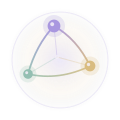
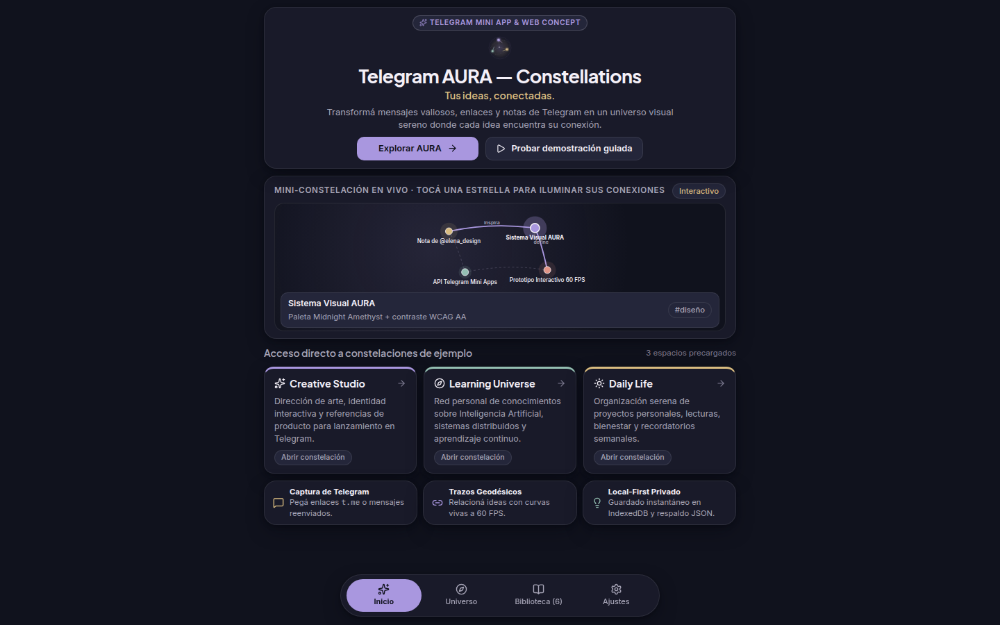
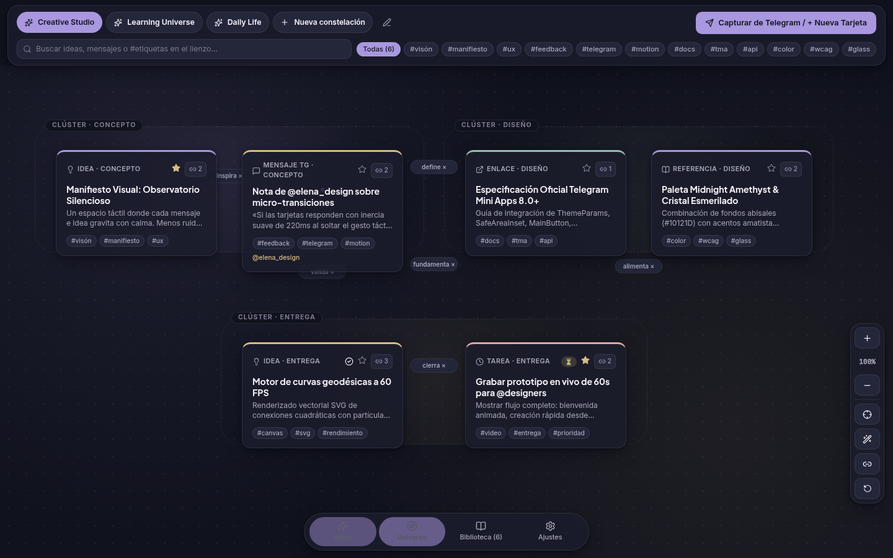
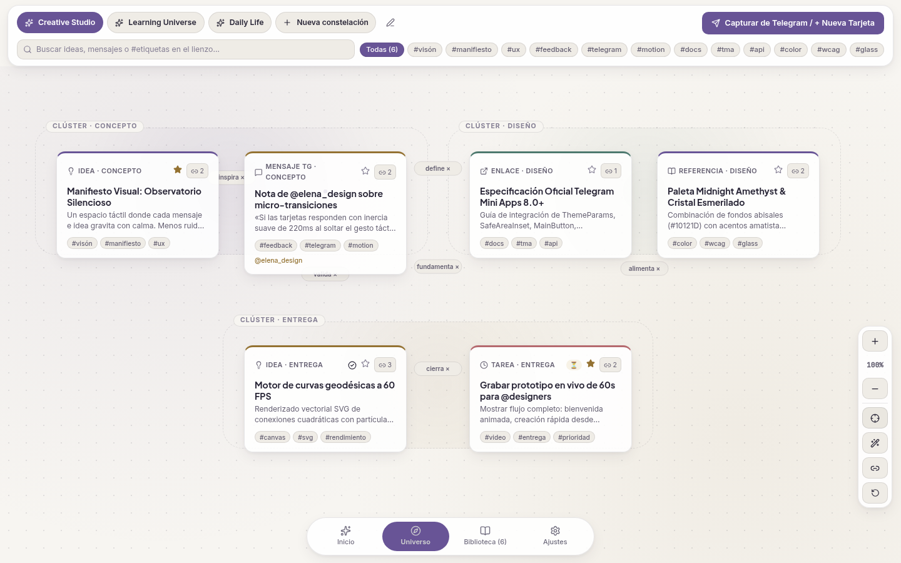
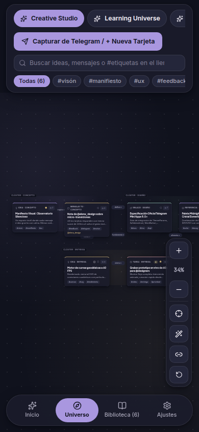
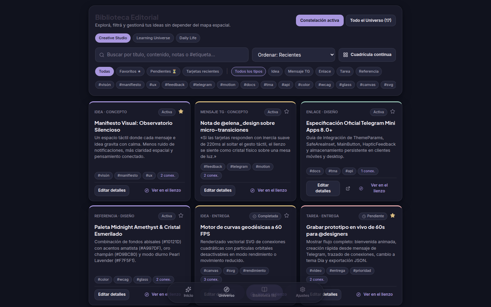
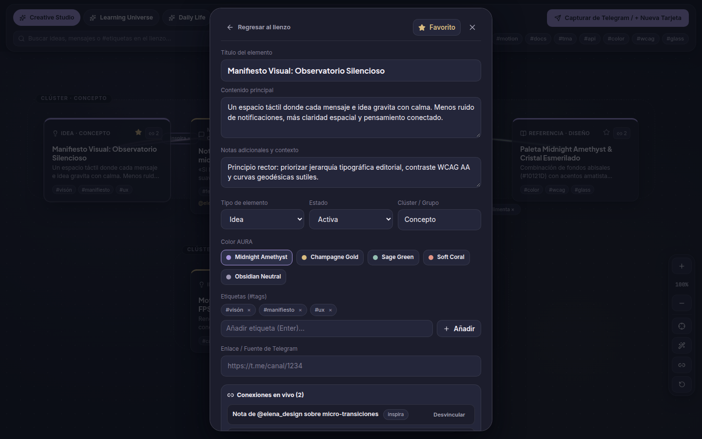

<div align="center">



# Telegram AURA — Constellations

### *«Tus ideas, conectadas.»*

**Un observatorio visual sereno e interactivo para transformar mensajes valiosos, enlaces y notas de Telegram en constelaciones vivas de conocimiento.**

[](#licencia)
[](#stack-tecnológico)
[](#stack-tecnológico)
[](./DESIGN_SYSTEM.md)
[](./ARCHITECTURE.md)

</div>

---

## 1. Filosofía Central y Objetivos

En Telegram circulan cada día algunas de nuestras mejores ideas: fragmentos de conversaciones técnicas, recomendaciones culturales, enlaces de investigación, notas de voz transcritas y recordatorios personales. Sin embargo, cuando los enviamos a *Mensajes Guardados* (*Saved Messages*), terminan sepultados en un flujo cronológico infinito donde el contexto relacional desaparece.

**Telegram AURA — Constellations** nace con una premisa clara: **el pensamiento humano no es una lista vertical cronológica, sino una red espacial de asociaciones**.

### Objetivos del Proyecto
1. **Calma cognitiva frente al ruido:** Reemplazar la ansiedad del *feed* infinito por la serenidad de un observatorio astronómico contemporáneo (**Aura Design System**), con paleta *Midnight Amethyst* (Nocturno) y *Pearl Lavender* (Diurno).
2. **Memoria espacial real:** Permitir ubicar tarjetas en un lienzo 2D fluido a 60 FPS, agruparlas en clústeres temáticos con halos atmosféricos y trazar **curvas geodésicas de conexión** (`inspira`, `depende de`, `amplía`, `referencia`, `conecta`) que revelan cómo dialogan las ideas entre sí.
3. **Captura sin fricción desde Telegram:** Convertir cualquier enlace `https://t.me/...`, mensaje reenviado (`Reenviado de @canal: ...`) o apunte rápido con `#etiquetas` en una estrella estructurada dentro de su constelación en segundos.
4. **Privacidad *Local-First* verificable:** Garantizar que todas las constelaciones, notas y coordenadas residan por defecto en el dispositivo del usuario mediante `IndexedDB`, con exportación e importación íntegra en JSON validado con `Zod` y cero telemetría.

---

## 2. Galería Visual de la Aplicación Real

Todas las capturas que se muestran a continuación fueron tomadas directamente del sistema en ejecución (en resoluciones de escritorio `1440×900` y vista móvil `390×844` estilo Telegram Mini App):

### Pantalla de Bienvenida e Identidad (`Midnight Amethyst`)


### Lienzo de Constelaciones — Modo Nocturno (`Midnight Amethyst`)


### Lienzo de Constelaciones — Modo Diurno (`Pearl Lavender`)


### Vista Móvil (`390×844`) — Ergonomía Telegram Mini App
<div align="center">
  
</div>

### Biblioteca Editorial Estructurada (Filtros, Ordenamiento y Clústeres)


### Hoja de Detalles y Gestor de Conexiones en Vivo


---

## 3. Características Principales Implementadas

El proyecto implementa de extremo a extremo las **15 capacidades obligatorias del MVP**, además de modos avanzados de simulación y pruebas de estrés:

1. **Crear tarjetas nuevas** con título, contenido, notas adicionales, tipo (`idea`, `message`, `link`, `task`, `reference`), color AURA (`amethyst`, `gold`, `sage`, `coral`, `neutral`), etiquetas (`#tags`), estado (`active`, `pending`, `completed`), clúster y enlace fuente.
2. **Editar tarjetas en vivo** desde la Hoja de Detalles (`CardDetailSheet`) con persistencia inmediata en `IndexedDB`.
3. **Eliminar tarjetas con confirmación de 2 pasos** (`Eliminar tarjeta` → `Sí, eliminar`) y limpieza automática en cascada de todas sus conexiones asociadas.
4. **Mover tarjetas libremente (Drag & Drop a 60 FPS)** sobre el lienzo con soporte nativo de `Pointer Events` y guardado automático de coordenadas `(x, y)`.
5. **Conectar y desconectar tarjetas** mediante curvas Bézier cúbicas tanto desde el lienzo interactivo (**Modo Conectar** con línea guía en tiempo real) como desde el selector relacional en la Hoja de Detalles.
6. **Crear, renombrar, cambiar ícono/color y eliminar constelaciones** (espacios de trabajo independientes) desde el selector superior y su modal dedicado.
7. **3 Constelaciones de demostración ricas precargadas** desde el primer arranque:
   - **`Creative Studio`** (6 tarjetas, 6 conexiones): Dirección de arte, feedback de `@elena_design` y lanzamiento en Telegram.
   - **`Learning Universe`** (6 tarjetas, 5 conexiones): Grafos de conocimiento, memoria espacial, IA local y seguridad HMAC.
   - **`Daily Life`** (5 tarjetas, 4 conexiones): Rituales de enfoque, lecturas astronómicas y planes personales.
8. **Búsqueda instantánea en tiempo real** por título, contenido, notas, clúster o etiquetas tanto en el Lienzo (atenuando los nodos no coincidentes) como en la Biblioteca.
9. **Filtrado multicriterio** por etiquetas (`#tags`), tipo de tarjeta, favoritos (`★`), pendientes (`⏳`), recientes y alcance (*Constelación activa* vs *Todo el Universo*).
10. **Cambio de vistas sin recarga** mediante la barra inferior flotante ergonómica (`BottomDock`): **Inicio**, **Universo**, **Biblioteca** y **Ajustes**.
11. **Temas visuales duales y adaptativos:** **Nocturno (*Midnight Amethyst*)**, **Diurno (*Pearl Lavender*)** y **Automático** (sincronizado con `prefers-color-scheme` o `Telegram.WebApp.colorScheme`).
12. **Persistencia local robusta (`IndexedDB` + fallback seguro)** que conserva intacto el estado al recargar la página o cerrar el navegador.
13. **Exportación e importación de respaldo JSON** con validación estricta mediante esquemas `Zod`, protección anti-*Prototype Pollution* y modos **Combinar (*Merge*)** o **Reemplazar (*Replace*)**.
14. **Captura inteligente desde Telegram (`parseTelegramInput`)**: detecta automáticamente enlaces `https://t.me/...`, encabezados de mensajes reenviados (`Reenviado de @canal: ...`), menciones `@usuario`, intenciones de tarea (`TODO:`) y `#hashtags`.
15. **Auto-organización geométrica armónica (`autoArrangeActiveConstellation`)** y controles de cámara completos (Zoom `+`/`-`, indicador `100%`, centrar mapa y ajuste automático de encuadre con `ResizeObserver`).
16. **Laboratorio de Estrés de Rendimiento (+105 nodos):** Generador integrado en *Ajustes* que despliega una constelación en espiral áurea (*filotaxis*) con **105 tarjetas y sus conexiones vectoriales** para comprobar la fluidez real a 60 FPS.
17. **Marco de Vista Previa Telegram Mini App (390×844px):** Conmutador en *Ajustes* que permite simular en pantallas de escritorio la carcasa móvil exacta de una Mini App dentro de Telegram.

---

## 4. Stack Tecnológico

| Capa | Tecnología | Propósito |
| :--- | :--- | :--- |
| **Frontend UI & Estado** | **React 19.3 + TypeScript 7 (Strict)** | Arquitectura declarativa de componentes, hooks y estado reactivo con tipado estricto. |
| **Empaquetador & Dev Server** | **Vite 8** | Arranque instantáneo con HMR y build de producción optimizado. |
| **Motor de Lienzo** | **React Pointer Events + SVG Vectorial + CSS3 3D Transforms** | Lienzo astronómico propio acelerado por GPU (`translate3d` + `scale`) sin librerías pesadas de terceros. |
| **Persistencia Local** | **IndexedDB (`idb` 8.0) + Fallback validado** | Base de datos transaccional en el navegador con índices por constelación e integridad referencial en cascada. |
| **Validación & Sanitización** | **Zod 4.6** | Validación estricta de esquemas en respaldos JSON, sanitización anti-XSS y lista blanca de protocolos URL (`https:`, `http:`, `tg:`). |
| **Iconografía & Tipografía** | **Lucide React + Plus Jakarta Sans, Inter & JetBrains Mono** | Sistema editorial limpio y semántico coherente con *Aura Design System*. |
| **Puente Opcional TMA Backend** | **Python 3.12 + FastAPI + SQLite3** (`backend_tma/`) | Verificación criptográfica oficial `HMAC-SHA256` de `initData`, webhook de captura vía Bot y buzón parametrizado. |
| **Pruebas Automatizadas** | **Vitest + Testing Library + fake-indexeddb + Playwright + unittest** | Pirámide completa de pruebas unitarias, integración, E2E en navegador real Chromium y backend Python. |

---

## 5. Instrucciones Paso a Paso: Instalación, Ejecución, Build y Pruebas

### Requisitos Previos
- **Node.js** `>= 20.x` y **npm** `>= 10.x`.
- **Python** `>= 3.10` (opcional, únicamente si deseas ejecutar las pruebas o el servidor del puente `backend_tma`).

### 5.1. Instalación de Dependencias
Desde la raíz del proyecto:

```bash
npm install
```

### 5.2. Ejecución en Modo Desarrollo
Inicia el servidor de desarrollo de Vite en el puerto `5173`:

```bash
npm run dev
```

Abre en tu navegador: **`http://localhost:5173`**  
*(La aplicación funciona al 100% de manera autónoma desde el primer segundo, sin requerir claves API ni variables de entorno).*

### 5.3. Build de Producción y Vista Previa
Para compilar TypeScript y generar el paquete estático optimizado en `dist/`:

```bash
npm run build
npm run preview
```

El servidor de previsualización quedará disponible en **`http://localhost:4173`**.

### 5.4. Ejecución de la Suite de Pruebas
El proyecto cuenta con verificación automatizada en cuatro niveles:

1. **Pruebas Unitarias y de Integración Frontend (Vitest + IndexedDB real en memoria):**
   ```bash
   npm test
   ```
2. **Pruebas End-to-End en Navegador Real (Playwright Chromium):**
   ```bash
   npx playwright test
   ```
3. **Pruebas Unitarias y de Seguridad Criptográfica del Backend TMA (Python `unittest`):**
   ```bash
   python3 -m unittest discover -s backend_tma -p "test_*.py" -v
   ```

---

## 6. Resumen de Arquitectura y las 3 Modalidades del Proyecto

Para mantener una honestidad técnica absoluta (detallada en profundidad en [`ARCHITECTURE.md`](./ARCHITECTURE.md)), **Telegram AURA — Constellations** distingue claramente tres niveles de operación:

1. **Modalidad 1 — Demostración Web Funcional (100% Operativa sin configuración externa):**
   Se ejecuta en cualquier navegador moderno de escritorio o móvil. Incluye las 3 constelaciones de ejemplo, captura inteligente pegando enlaces `https://t.me/...` o textos reenviados, persistencia en `IndexedDB`, respaldo JSON y el **Marco de vista previa Telegram Mini App (390px)**.
2. **Modalidad 2 — Telegram Mini App Auténtica (`window.Telegram.WebApp` + `backend_tma/`):**
   AURA incorpora el puente nativo `src/services/telegramBridge.ts` que detecta automáticamente el entorno `Telegram.WebApp`, invoca `ready()`, `expand()` y `disableVerticalSwipes()`, sincroniza los colores de cabecera (`#10121D` / `#F7F5F1`), respeta `safeAreaInset` y activa vibraciones hápticas (`HapticFeedback`). Además, incluye el micro-backend opcional en `backend_tma/` (FastAPI + SQLite) que valida criptográficamente `initData` mediante `HMAC-SHA256` y recibe mensajes reenviados voluntariamente a un Bot de Telegram.
3. **Modalidad 3 — Propuesta Conceptual de Función Nativa del Cliente Telegram:**
   En [`ARCHITECTURE.md`](./ARCHITECTURE.md) se documenta cómo esta experiencia podría integrarse de forma nativa dentro de los clientes oficiales de Telegram (iOS, Android, Desktop, WebK/WebZ) como una vista espacial sobre **Mensajes Guardados (*Saved Messages*)** apoyada en **TDLib**.

### Limitaciones Oficiales de la API de Telegram (Transparencia Técnica)
De acuerdo con las políticas de privacidad y seguridad de Telegram:
- **Un Bot o Mini App NO puede leer conversaciones privadas arbitrarias del usuario.** Solo puede recibir mensajes que el usuario envíe o reenvíe explícitamente al Bot, o enlaces `https://t.me/...` que el usuario decida capturar en su lienzo.
- **Un plugin web externo NO puede modificar el código nativo del cliente oficial de Telegram.** Por ello, la implementación entregada se estructura como Web App / Telegram Mini App estándar de producción.

---

## 7. Documentación Oficial del Repositorio

- 📘 [**`DESIGN_SYSTEM.md`**](./DESIGN_SYSTEM.md): Filosofía estética *Aura Design System*, tablas completas de tokens de color (*Midnight Amethyst* y *Pearl Lavender*), ratios WCAG 2.2 AA, tipografía, geometría del símbolo `AuraLogo` y componentes.
- 🏛️ [**`ARCHITECTURE.md`**](./ARCHITECTURE.md): Estructura modular, motor de lienzo astronómico propio en React + SVG, persistencia *local-first* en `IndexedDB` y análisis técnico de las 3 modalidades.
- 🗺️ [**`ROADMAP.md`**](./ROADMAP.md): Desglose claro entre funciones terminadas (MVP v1.0), mejoras de Fase 2 (`CloudStorage`, exportación SVG/PNG) e ideas experimentales de Fase 3.
- 🛡️ [**`SECURITY.md`**](./SECURITY.md): Privacidad por diseño, prevención de XSS, validación Zod anti-*Prototype Pollution* y verificación criptográfica `HMAC-SHA256` en tiempo constante.
- 🎬 [**`DEMO.md`**](./DEMO.md): Guía de prueba rápida en 30 segundos, recorrido interactivo en vivo y guion técnico de grabación en 7 escenas (60–90s).

---

## 8. Licencia

Este proyecto se distribuye bajo la **Licencia MIT**. Consulta los detalles de uso libre y atribución en el archivo `package.json`.
